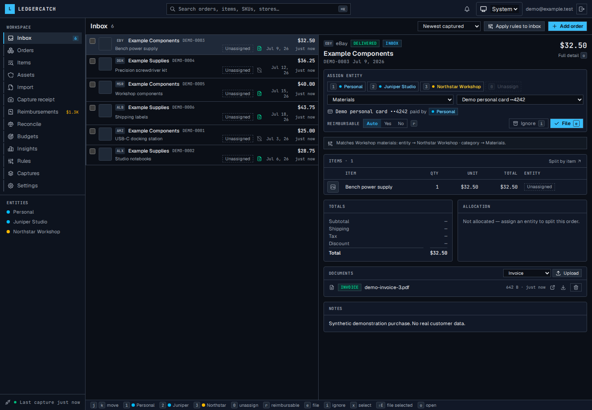
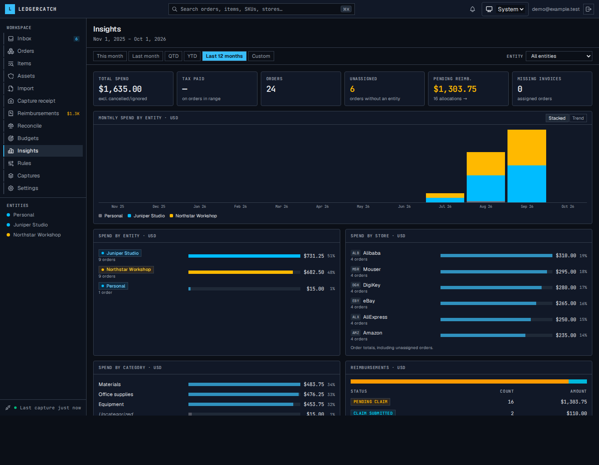

# LedgerCatch

A self-hosted purchase ledger for personal spending and small businesses. Capture purchases once, file them to the right entity, keep the invoice, reconcile statements, and track reimbursements.



The screenshots show fictional demonstration data in the running application.

## What it does

- Browser extension, email, spreadsheets, documents and mobile receipt capture.
- Versioned parsers for Amazon, AliExpress, Alibaba, eBay, DigiKey, Mouser and common storefront platforms; optional AI extraction.
- Inbox triage, rules, item/entity splits, invoice storage, refunds, assets and warranties.
- Reimbursements, claims, statement matching, budgets and spending insights.
- Invoice Ninja expense exports and optional explicitly configured HTTP connections.
- Owner-scoped REST/OpenAPI and MCP APIs, accountant sharing and background jobs.



## Try the isolated demo

Requires Docker Compose, Bun 1.4.2 and Node 24.21.0. This repository is standalone.

```sh
bun install --frozen-lockfile
bun install --cwd extension --frozen-lockfile
bun run demo:setup
bun run demo:start
```

Open <http://127.0.0.1:4300>. Sign in as `demo@example.test` using the normal magic link delivered to Mailpit at <http://127.0.0.1:58025>. The setup generates local secrets and seeds 24 synthetic orders totaling **$1,635.00**, three entities and example claims, documents and reconciliation suggestions. No demo login bypass exists.

See [Demo and screenshots](docs/DEMO.md), [Installation](docs/INSTALL.md), [Connections](docs/CONNECTIONS.md), [API](docs/API.md), [Backups and upgrades](docs/OPERATIONS.md) and [Architecture](docs/ARCHITECTURE.md).

## Development

```sh
bun run lint
bun run typecheck
bun run test:demo            # creates and drops a separate test database
bun run --cwd extension typecheck
bun run --cwd extension test
bun run extension:package
bun run build:runtime
bun run demo:screenshots     # while demo:start is running
```

`bun run test` requires `TEST_DATABASE_URL` pointing to an explicit disposable local/CI PostgreSQL admin database. It creates a unique migrated test database. It never falls back to a configured application database. Run heavy builds/tests sequentially.

Set `APP_NAME`, `VITE_APP_NAME` and `EXT_APP_NAME` to customize display names. Browser names are build-time configuration.

## Current limits

External store/accounting services and store publication require operator validation; local fakes are not external certification. Chrome is the packaged extension target. Linux amd64 is the initial container verification target; arm64 is not advertised. Custom HTTP import supports bounded JSON OpenAPI 3.0/3.1 with inline schemas, explicit flat mappings and provider-confirmed idempotency. It does not infer accounting semantics.

Licensed under [MIT](LICENSE). The intended public destination is `formless63/ledgercatch`; repository creation and publication are separate owner-authorized steps. Dependency notices are recorded separately. See [Release preparation](docs/RELEASING.md).
